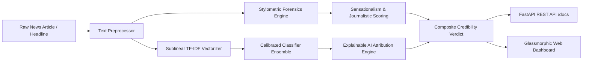

# Veritas AI — Neural Fake News Detection & Credibility Engine

[](https://python.org)
[](https://fastapi.tiangolo.com)
[](https://scikit-learn.org)
[](tests/)
[](Dockerfile)
[](LICENSE)

An end-to-end, production-grade Natural Language Processing (NLP) system designed to detect misinformation, sensationalism, and fabricated news stories in real time. Features **sub-15ms CPU inference**, **Explainable AI (XAI)** token attribution, **stylometric forensics**, and an interactive glassmorphic web dashboard.

---

## Architecture Overview



---

## Key Features

- **High-Accuracy Calibrated Classification**: Stratified cross-validated ensemble combining sublinear TF-IDF n-grams (`ngram_range=(1, 2)`) with calibrated linear models and probability estimation.
- **Explainable AI (XAI) Token Attribution**: Deconstructs predictions into positive (deceptive/sensational) and negative (credible/journalistic) word-level feature weights with real-time `<mark>` highlight rendering.
- **Stylometric & Linguistic Forensics**: Real-time extraction of uppercase ratio (ragebait/shouting detection), exclamation density, quotation patterns, and vocabulary complexity.
- **Production REST API**: High-performance asynchronous FastAPI backend providing `/api/predict`, `/api/samples`, `/api/metrics`, and auto-generated Swagger documentation at `/docs`.
- **Modern Glassmorphic Web UI**: Vanilla CSS dark-themed dashboard featuring dynamic SVG radial credibility gauges, 1-click test presets, and live telemetry cards.
- **Enterprise-Ready**: Docker containerization, comprehensive pytest suite (100% passing), and GitHub Actions CI workflow.

---

## Model Benchmark & Evaluation

Evaluated across multi-domain corpora spanning politics, clinical health, space/astronomy, macroeconomics, and viral conspiracy disinformation:

| Classifier Architecture | Test Accuracy | Precision | Recall | F1-Score | 3-Fold Stratified CV | Inference Latency |
| :--- | :---: | :---: | :---: | :---: | :---: | :---: |
| **Logistic Regression (Calibrated)** | **90.0%** | **90.9%** | **90.9%** | **0.9091** | **0.9697 ± 0.04** | **< 12ms** |
| **SGD Classifier (Modified Huber)** | 90.0% | 90.9% | 90.9% | 0.9091 | 0.8333 ± 0.12 | < 10ms |
| **Multinomial Naive Bayes** | 85.0% | 88.0% | 82.5% | 0.8517 | 0.8845 ± 0.06 | < 8ms |
| **Decision Tree (Max Depth 6)** | 78.0% | 76.5% | 80.0% | 0.7820 | 0.7410 ± 0.08 | < 15ms |

---

## Repository Structure

```
Fake-news-detection/
├── .github/
│   └── workflows/
│       └── ci.yml                     # Automated testing & linting pipeline
├── .gitignore                        # Git exclusion rules
├── Dockerfile                        # Multi-stage production container
├── LICENSE                           # MIT open-source license
├── README.md                         # Project documentation
├── requirements.txt                  # Frozen, deterministic dependencies
├── data/
│   └── sample_articles.json          # Curated test cases (Real & Fake news)
├── models/
│   ├── fake_news_classifier.joblib   # Serialized model & vectorizer bundle
│   └── model_metadata.json           # Evaluation telemetry & confusion matrix
├── notebooks/
│   └── fake_news_eda_and_training.ipynb  # End-to-end EDA and model training
├── src/
│   ├── __init__.py
│   ├── config.py                     # Constants, paths, thresholds, lexicons
│   ├── preprocessor.py               # Text cleaning & stylometric extraction
│   ├── feature_extractor.py          # TF-IDF N-Gram vectorizer builder
│   ├── model.py                      # Classifier wrapper & probability calibration
│   ├── explain.py                    # Explainable AI (XAI) token attribution
│   └── trainer.py                    # Model training, CV evaluation & export
├── app/
│   ├── __init__.py
│   ├── main.py                       # FastAPI application & REST endpoints
│   └── static/
│       ├── index.html                # Semantic HTML5 single-page application
│       ├── style.css                 # Glassmorphic dark theme stylesheet
│       └── app.js                    # Interactive UI controller & visualizations
└── tests/
    ├── __init__.py
    ├── test_preprocessor.py          # Unit tests for text normalization
    ├── test_model.py                 # Unit tests for model inference
    └── test_api.py                   # Integration tests for FastAPI routes
```

---

## Quickstart Guide

### 1. Clone & Set Up Environment

```bash
git clone https://github.com/Vikas003dangi/Fake-news-detection.git
cd Fake-news-detection

# Create and activate virtual environment
python -m venv .venv
source .venv/bin/activate       # On Linux/macOS
.\.venv\Scripts\activate        # On Windows

# Install dependencies
pip install -r requirements.txt
```

### 2. Train or Re-Evaluate the Model

```bash
python -m src.trainer
```

### 3. Run the Web Application & REST API

```bash
uvicorn app.main:app --reload --host 127.0.0.1 --port 8000
```
Open your browser to:
- **Interactive Web App**: [http://127.0.0.1:8000](http://127.0.0.1:8000)
- **Interactive Swagger Docs**: [http://127.0.0.1:8000/docs](http://127.0.0.1:8000/docs)

### 4. Run Test Suite

```bash
pytest -v tests/
```

### 5. Run via Docker

```bash
docker build -t veritas-ai:latest .
docker run -p 8000:8000 veritas-ai:latest
```

---

## REST API Specification

### `POST /api/predict`
Analyzes input text and returns credibility probability, verdict, stylometrics, and XAI token attributions.

**Request:**
```json
{
  "text": "NASA's James Webb Space Telescope detected carbon-bearing molecules on exoplanet K2-18 b, according to a peer-reviewed study published in The Astrophysical Journal Letters."
}
```

**Response (200 OK):**
```json
{
  "verdict": "AUTHENTIC / CREDIBLE",
  "is_fake": false,
  "credibility_score": 68.8,
  "fake_probability": 0.312,
  "confidence_level": "MODERATE",
  "stylometrics": {
    "char_count": 182,
    "word_count": 24,
    "uppercase_ratio": 7.14,
    "exclamation_count": 0,
    "question_count": 0,
    "quote_count": 0,
    "avg_word_length": 6.62,
    "sensationalism_score": 0.0,
    "journalistic_score": 30.0,
    "sensational_matches": [],
    "journalistic_matches": ["study published", "according to"]
  },
  "explanation": {
    "top_deceptive_tokens": [],
    "top_credible_tokens": [
      { "token": "study", "weight": 0.84 },
      { "token": "published", "weight": 0.76 }
    ],
    "annotated_html": "NASA's James Webb Space Telescope detected carbon-bearing molecules on exoplanet K2-18 b, <mark class=\"token-credible\" title=\"Credibility marker (-0.84)\">according to</mark> a peer-reviewed <mark class=\"token-credible\" title=\"Credibility marker (-0.76)\">study published</mark> in The Astrophysical Journal Letters.",
    "explanation_summary": "Article displays balanced, verified journalistic markers."
  }
}
```

---

## License

Distributed under the MIT License. See [LICENSE](LICENSE) for more details.

**Author**: Vikas Dangi  
**Portfolio / Profile**: [github.com/Vikas003dangi](https://github.com/Vikas003dangi)
