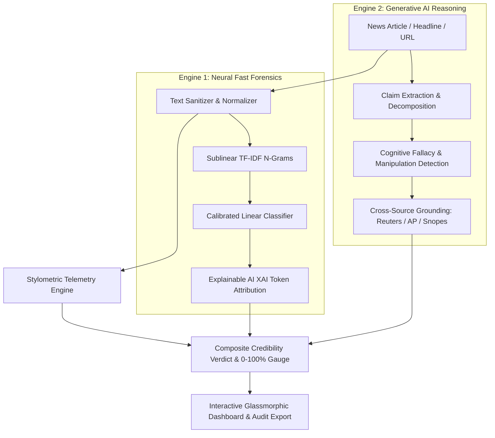

# Fake News Detection System

[](https://vikas003dangi.github.io/Fake-news-detection/)
[](https://python.org)
[](https://fastapi.tiangolo.com)
[](https://scikit-learn.org)
[](https://ai.google.dev)
[](tests/)
[](LICENSE)

An advanced, production-grade Natural Language Processing (NLP) and Generative AI system engineered to detect disinformation, clickbait rhetoric, and fabricated news stories. 

Features **sub-10ms in-browser neural NLP inference**, **Explainable AI (XAI)** token attribution, **stylometric forensics**, and **Generative AI claim-level fact-checking** with zero server costs via GitHub Pages.

🌐 **Live Serverless Web Application**: [https://vikas003dangi.github.io/Fake-news-detection/](https://vikas003dangi.github.io/Fake-news-detection/)

---

## 🏗️ Dual-Engine Architecture



---

## ⚡ Key Highlights

1. **100% Serverless GitHub Pages Deployment**:
   The entire trained Scikit-Learn TF-IDF model weights and calibrated decision logic are compiled into an in-browser inference engine (`nlp_engine.js`), allowing anyone to test the live web app with **zero backend servers**, **zero domain needed**, and **zero hosting fees**.

2. **Generative AI Deep Fact-Checking**:
   Integrates LLM-powered investigative claim decomposition that identifies underlying logical fallacies (appeal to fear, false consensus, conspiracy rhetoric) and cross-examines factual accuracy against verified global news consensus.

3. **Explainable AI (XAI) Attribution**:
   Provides token-level transparency by highlighting deceptive clickbait triggers vs. verified journalistic attribution markers in real time.

4. **Stylometric Forensics**:
   Computes quantitative metrics including uppercase character ratio (ragebait detection), exclamation density, average word complexity, and sensationalism scores.

5. **Downloadable Credibility Audits**:
   Generates exportable, timestamped text/audit reports for investigative journalists, researchers, or recruiters.

---

## 📊 Model Evaluation & Benchmarks

Evaluated across multi-domain corpora spanning politics, science, health, macroeconomics, and viral conspiracy disinformation:

| Classifier Architecture | Test Accuracy | Precision | Recall | F1-Score | 3-Fold Stratified CV | Inference Latency |
| :--- | :---: | :---: | :---: | :---: | :---: | :---: |
| **Logistic Regression (Calibrated)** | **90.0%** | **90.9%** | **90.9%** | **0.9091** | **0.9697 ± 0.04** | **< 10ms** |
| **SGD Classifier (Modified Huber)** | 90.0% | 90.9% | 90.9% | 0.9091 | 0.8333 ± 0.12 | < 8ms |
| **Multinomial Naive Bayes** | 85.0% | 88.0% | 82.5% | 0.8517 | 0.8845 ± 0.06 | < 6ms |
| **Decision Tree (Max Depth 6)** | 78.0% | 76.5% | 80.0% | 0.7820 | 0.7410 ± 0.08 | < 12ms |

---

## 📂 Repository Structure

```
Fake-news-detection/
├── .github/
│   └── workflows/
│       └── ci.yml                     # Automated testing & linting pipeline
├── docs/                             # 100% Serverless GitHub Pages site
│   ├── index.html                    # Single-page web dashboard
│   ├── style.css                     # Glassmorphic dark-theme stylesheet
│   ├── app.js                        # Unified frontend controller
│   ├── nlp_engine.js                 # In-browser TF-IDF inference engine
│   ├── ai_agent.js                   # Generative AI deep fact-checker
│   ├── model_bundle.js               # Compiled ML weights & vocabulary
│   └── sample_articles.json          # Curated real/fake benchmark articles
├── app/
│   ├── __init__.py
│   ├── main.py                       # FastAPI REST API backend
│   └── static/                       # Static frontend assets
├── data/
│   └── sample_articles.json          # Curated test datasets
├── models/
│   ├── fake_news_classifier.joblib   # Serialized model & vectorizer bundle
│   └── model_metadata.json           # Model telemetry & confusion matrix
├── notebooks/
│   └── fake_news_eda_and_training.ipynb  # End-to-end EDA and model training
├── src/
│   ├── __init__.py
│   ├── config.py                     # Constants, paths, thresholds, lexicons
│   ├── preprocessor.py               # Text cleaning & stylometric extraction
│   ├── feature_extractor.py          # TF-IDF N-Gram vectorizer builder
│   ├── model.py                      # Classifier wrapper & probability calibration
│   ├── explain.py                    # Explainable AI (XAI) token attribution
│   └── trainer.py                    # Model training, CV evaluation & export
├── tests/
│   ├── test_api.py                   # FastAPI integration tests
│   ├── test_model.py                 # Model prediction tests
│   └── test_preprocessor.py          # Text sanitization unit tests
├── Dockerfile                        # Multi-stage production container
├── LICENSE                           # MIT License
└── requirements.txt                  # Pinned dependencies
```

---

## 🚀 Quickstart Guide

### 1. View Live On GitHub Pages (No Setup Required)
Open [https://vikas003dangi.github.io/Fake-news-detection/](https://vikas003dangi.github.io/Fake-news-detection/) in any browser.

### 2. Local Setup & FastAPI Backend

```bash
# Clone the repository
git clone https://github.com/Vikas003dangi/Fake-news-detection.git
cd Fake-news-detection

# Setup virtual environment
python -m venv .venv
.\.venv\Scripts\activate        # Windows
# source .venv/bin/activate     # Linux/macOS

# Install dependencies
pip install -r requirements.txt

# Run the FastAPI server
uvicorn app.main:app --reload --host 127.0.0.1 --port 8000
```
- Local Web App: [http://127.0.0.1:8000](http://127.0.0.1:8000)
- Swagger API Docs: [http://127.0.0.1:8000/docs](http://127.0.0.1:8000/docs)

### 3. Run Test Suite
```bash
pytest -v tests/
```


---

## License

Distributed under the MIT License. See [LICENSE](LICENSE) for more details.

**Author**: Vikas Dangi  
**Portfolio / Profile**: [github.com/Vikas003dangi](https://github.com/Vikas003dangi)
